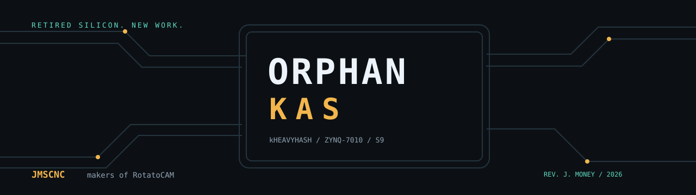

# ORPHAN KAS

### Retired silicon. New work.

**A real kHeavyHash engine for the FPGA inside an Antminer S9 control board.** ARM runs the control plane. Programmable logic does the hashing. Your old Bitcoin control board gets a second career.

**By [JMSCNC](https://jmscnc.com), makers of [RotatoCAM](https://rotatocam.com).**  
**Copyright © 2026 Rev. J. Money.** Part of **Orphan · FPGA Dev Linux for the S9 Control Board**.

[](https://buymeacoffee.com/revjmoney)

## Quick start and mine

You need an S9 **control board** running Orphan/Ardzy from SD, reachable by SSH. The S9 hashboards are not used by this engine. Keep their cables disconnected for this project.

**1. Deploy from your Windows PC.** Clone this private repository locally, then:

```powershell
./deploy.ps1 -Board <board-ip>
```

The deployer checks the bitstream and timing report, copies the project onto the existing SD filesystem, stops the old LED register writer, and loads `orphan_kas` through Ardzy. It preserves the default project and does not change the bootloader or NAND.

**2. Open `http://YOUR_BOARD_IP:8000`.** Run **known-answer self-test**, then **Benchmark 1M nonces**. A completed hash is recomputed on ARM before the software marks it verified.

**3. Set your wallet and pool.** In **Wallet & pool**:

| Setting | Enter |
| --- | --- |
| Active wallet | Your full Kaspa receive address, including `kaspa:` |
| Pool / bridge | `stratum+tcp://HOST:PORT` or `stratum+ssl://HOST:PORT` |
| Worker | A name such as `orphan-s9` |
| Pool password | The value required by your pool, commonly `x` |

Press **Save settings**, then **Start mining**. The wallet chooser remembers multiple receive addresses. Press **Stop** before changing the active wallet or pool. Settings remain on the SD card in a git-ignored file.

For two controllers on one pool account, use the same pool and receive address on both, with distinct worker names such as `orphan-s9-1` and `orphan-s9-2`. Each board connects independently. The pool adds their contributed work under that address and reports each worker separately if it supports worker stats.

The first supported network dialect is **[Kaspa Stratum bridge](https://github.com/rdugan/kaspa-stratum-bridge)**: compact four-u64 jobs and 80-character jobs, difficulty notifications, extranonce prefixes, wallet authorization, and nonce submission. A generic Bitcoin Stratum server is not compatible. TLS endpoints use certificate verification.

The display counts **accepted** shares only after a positive server response. A found FPGA nonce is CPU-verified before submission. A local fake-pool test checks the protocol; an accepted share from a real pool is a separate milestone. No public pool or wallet is selected automatically.

**Earnings & payouts** estimates daily KAS and USD from the current network hashrate, block subsidy and KAS price. During a pool session it uses hashes counted over wall-clock time, including job changes and setup. The estimate uses the displayed FPGA rate when wall-clock measurements are unavailable. Enter measured wall power and your electricity price for an estimated net result. HeroMiners wallet statistics show the pool-reported payout minimum, seven-day paid amount and balance when available. Market and pool data refresh on a two-minute cache. Other pools can still mine through compatible Stratum endpoints, with payout stats left unavailable until a provider adapter is added.

**Prefer the terminal?** Once the project is loaded:

```sh
cd /opt/ardzy/projects/orphan_kas
python3 cli.py selftest
python3 cli.py watch
python3 cli.py settings --wallet 'kaspa:YOUR_RECEIVE_ADDRESS' \
  --pool 'stratum+tcp://YOUR_BRIDGE:5555' --worker orphan-s9
python3 cli.py mine
python3 cli.py stop
```

`watch` is the live terminal dashboard. Commands and the browser share one service, so two interfaces cannot independently overwrite FPGA jobs.

### Dev fee: 3 %, on by default, opt-out

Orphan KAS mines **3 % of the time** for its developer: for every 97 minutes mined to your wallet it reconnects to
**your same pool** with the developer's wallet (worker `orphan-devfee`) for 3 minutes, then switches back. The page
shows a **DEV FEE SLICE** badge while that runs, and the log says so. Time mined is remembered across restarts, so
stopping early never skips the fee or charges it twice (`orphan_kas/devfee.py`, ledger `devfee.local.json`).
**To opt out,** untick "3 % dev fee" in Wallet & pool and Save (or set `"devfee": false` in `settings.local.json`).
If you keep it on: thank you, it pays for more Orphan cores. Or [buy me a coffee](https://buymeacoffee.com/revjmoney).

## What the FPGA actually does

```text
 ARM / Debian 13                         Zynq-7010 programmable logic
 ─────────────────────                  ─────────────────────────────────
 Wallet + pool settings                 Job registers + matrix BRAM
 Kaspa Stratum client     AXI GP0        Inclusive 64-bit nonce counter
 Full-rank matrix       ──────────►      cSHAKE256("ProofOfWorkHash")
 CPU result oracle                      64 × 64 nibble matrix transform
 Web UI + terminal      ◄──────────      shift / pack / XOR
 Verified share submit                  cSHAKE256("HeavyHash")
                                        256-bit target comparison
                                        Orphan fan PWM + six tachometers
```

The mining datapath is **one autonomous FPGA lane**. It searches a nonce range without an ARM transaction per hash. The matrix is generated once per job with **xoshiro256++**, rejected unless it has rank 64, and uploaded through the established Orphan register bus. Eight block RAM banks feed 64 parallel nibble multipliers and a pipelined reduction, one matrix row per clock. Keccak uses fixed lane wiring with two phases per round. The deployer builds an optional native ARM matrix generator when GCC is available. The Python generator remains the fallback and independent reference.

Two on-chip slots overlap matrix multiplication with a shared Keccak engine. The target comparator retires completed hashes in nonce order, including when a match stops the search while another nonce is in flight. At 100 MHz, board #2 measured **980.4 kH/s** across a CPU-verified million-nonce benchmark. [Hardware verification](VERIFICATION.md)

The web console fits the live log, temperature, pool payouts and 45-second FPGA and wall-clock hashrate traces on a desktop screen. The illustrated chrome forge follows live FPGA activity. **FX** toggles its motion and the background rain. Use **Details** for self-test, fan PWM, benchmark and custom jobs.

The byte order is explicit:

* The pre-PoW hash is 32 serialized bytes.
* Timestamp and nonce are unsigned 64-bit little-endian values in the PoW message.
* The first hash is split high nibble first within each byte.
* Each matrix row is reduced with a 14-bit sum, shifted right by 10, and paired into bytes.
* The packed matrix result is XORed with the first hash before HeavyHash.
* Target comparison interprets the serialized hash as a little-endian 256-bit integer. The custom-job target field uses conventional numeric big-endian hex.

The original package's DDR DMA design is retained for reference. This implementation uses Orphan's existing AXI register transport and does not require a new DMA kernel module or overlay.

## Hardware target and build evidence

| Item | Target |
| --- | --- |
| Board | Bitmain Antminer S9 control board |
| SoC | Xilinx Zynq XC7Z010, CLG400, speed grade 1 |
| OS | Orphan / Ardzy, Debian 13, ARMv7 |
| FPGA bus clock | 100 MHz FCLK0 |
| Control interface | Existing Ardzy AXI GP0 register bus |
| Host service | Python standard library; no runtime pip dependencies |
| Cooling | Orphan `FAN1` peripheral in slot 15 |

Completed implementation evidence belongs in [`build-report.json`](build-report.json) and [`VERIFICATION.md`](VERIFICATION.md). The build script rejects failed timing before deployment. Published hashrate must come from hardware, including its measured clock and workload. The original four-core / multi-MH/s estimates are not measurements of this implementation.

## Register interface

Base window: `0x43C00000`, 16 slots of 4 KiB. **KAS1 occupies slot 1**, base `0x43C01000`.

| Word | Byte offset in slot | Register | Behavior |
| --- | --- | --- | --- |
| 0 | `0x000` | ID | `0x4B415331`, ASCII `KAS1` |
| 1 | `0x004` | COMMAND | bit 0 start, bit 1 stop, bit 2 clear |
| 2 | `0x008` | STATUS | busy, found, exhausted, stopped, invalid configuration in bits 0..4 |
| 3..4 | `0x00C` | HASHES | Completed hashes, low word first |
| 5..6 | `0x014` | CYCLES | Active bus-clock cycles, low word first |
| 7..8 | `0x01C` | LAST_NONCE | Most recently completed nonce |
| 9..16 | `0x024` | LAST_HASH | Eight words, serialized little-endian hash |
| 17 | `0x044` | VERSION | Register ABI version 1 |
| 64..71 | `0x100` | PRE_POW | 32 serialized hash bytes |
| 72..73 | `0x120` | TIMESTAMP | u64 milliseconds |
| 74..75 | `0x128` | NONCE_START | Inclusive u64 start |
| 76..77 | `0x130` | NONCE_END | Inclusive u64 end |
| 80..87 | `0x140` | TARGET | u256, low word first |
| 512..1023 | `0x800` | MATRIX | 64 rows × 8 packed u32 words; low nibble is first coefficient |

Configuration and matrix writes are ignored while busy. Start clears the previous result and counters. Search stops on a hit or at the inclusive end without wrapping. Stop resets the hashing pipeline and preserves completed work counters. A stopped run's last hash is a diagnostic result, not an accepted share. Read final hash/nonce fields after the engine is idle for a coherent result.

**Slot 0** is the Orphan project-info block. **Slot 15**, base `0x43C0F000`, remains the standard `FAN1` block used by `orphan-fan` and the Orphan Cooling screen. No hashboard data pins are assigned.

## Build it

The tested FPGA flow is Ardzy's **Yosys → nextpnr-himbaechel → fasm2bit** toolchain. Vivado is not required for this version. Point `ARDZY_PC_APP` at your Ardzy `pc_app` checkout containing its bundled FPGA tools:

```powershell
$env:ARDZY_PC_APP = 'C:\path\to\ardzy\pc_app'
python generate_keccak.py
python generate_states.py
python build.py
```

Generated Keccak RTL is committed so normal builds do not need regeneration. All generator inputs are in the repository. Windows build intermediates go to `%TEMP%\orphan-kas`; override `ORPHAN_BUILD_TEMP` if needed.

## Prove it

```sh
python -m pip install -r requirements-test.txt
python test_reference.py
python test_stratum.py
python test_api.py
python generate_tb.py
iverilog -g2012 -s tb_kas -o sim/kas.vvp \
  orphan_kas/kas_engine.v orphan_kas/kas_keccak.v orphan_kas/kas_matrix.v sim/tb_kas.v
vvp sim/kas.vvp
```

The CPU oracle is checked against an independent cSHAKE implementation and upstream Kaspa fixtures. RTL tests cover complete hashes, exact target equality, target-minus-one rejection, repeated jobs, nonce ranges near the u64 limit, exhaustion, stop, clear, and invalid ranges. Network tests use a local TCP fake pool and verify wallet/worker authorization, extranonce handling, submitted nonce encoding, and acknowledgement accounting.

On hardware, run the same hash vectors through the real AXI bus, compare every result to ARM, and benchmark only after the known-answer test passes. A bitstream fitting the device is not proof of hashing correctness.

## Project layout

```text
orphan_kas/                     Deployable Orphan FPGA project + host UI
  kas_engine.v                 Autonomous job / nonce / matrix engine
  kas_keccak.v                 Generated, constant-wired Keccak permutation
  kas_matrix.v                 Banked coefficient storage and row pipeline
  top.v, orphan_fan.v           Orphan bus, info, cooling integration
  reference.py, vectors.json    CPU oracle and known-answer jobs
  driver.py                    Bounded MMIO driver and hardware self-test
  stratum.py, settings.py       Mining session and local wallet settings
  main.py, index.html, cli.py   Web panel and terminal controls
sim/                           Assertion-based RTL testbench and upstream fixture
generate_*.py                  Reproducible RTL / testbench generators
build.py, deploy.ps1            Build gate and SD deployment
Oprhan_KAS_S9_Complete_Package/  Original supplied package, preserved verbatim
```

The general **CYD remote display and graphics transport live in the main Orphan project**, not in this mining repository. They can consume this service's `/api/status` endpoint.

## Credits and provenance

* **Rev. J. Money / JMSCNC:** Orphan project, board integration and branding.
* **chryso / [Ardzy](https://github.com/chrysovalantischryso/ardzy):** S9 Linux environment, FPGA toolchain and register-bus library.
* **[Kaspa](https://github.com/kaspanet/rusty-kaspa):** kHeavyHash consensus reference, domain states and verification fixtures.
* **YosysHQ, nextpnr contributors and the open FPGA tooling community:** synthesis and place-and-route foundations.

The original directory keeps its original spelling as an archival import. Current documentation and project names use **Orphan**.

---

**[JMSCNC](https://jmscnc.com) · [RotatoCAM](https://rotatocam.com) · Rev. J. Money · 2026**
